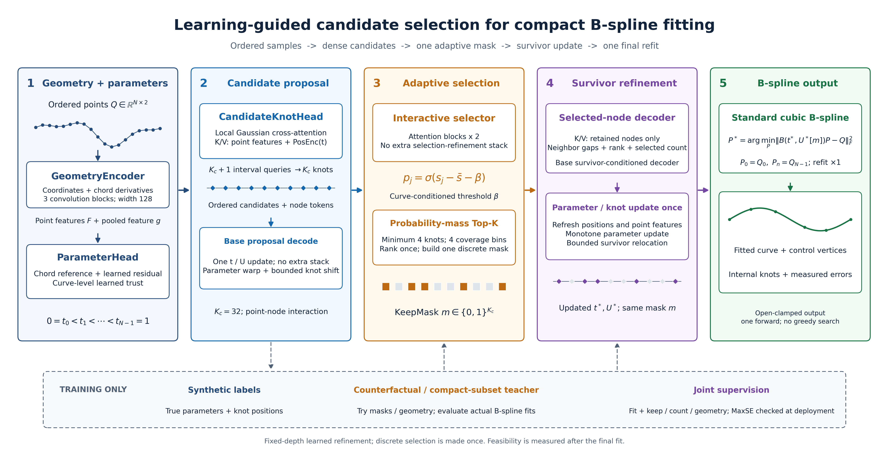
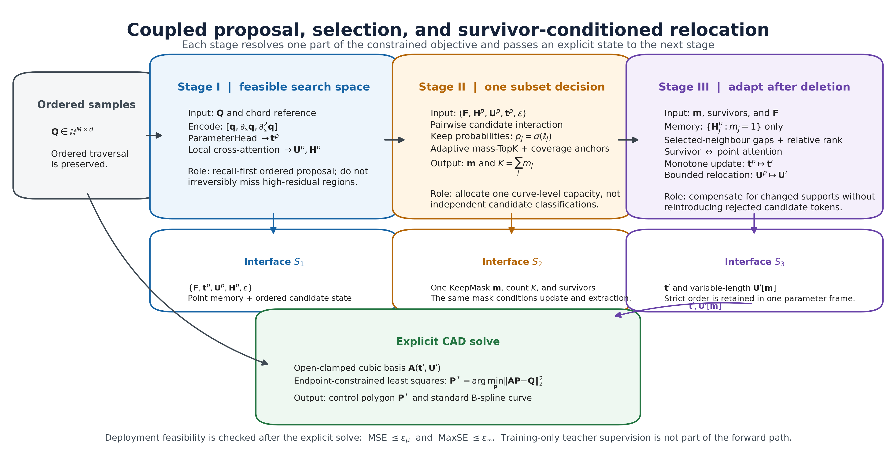
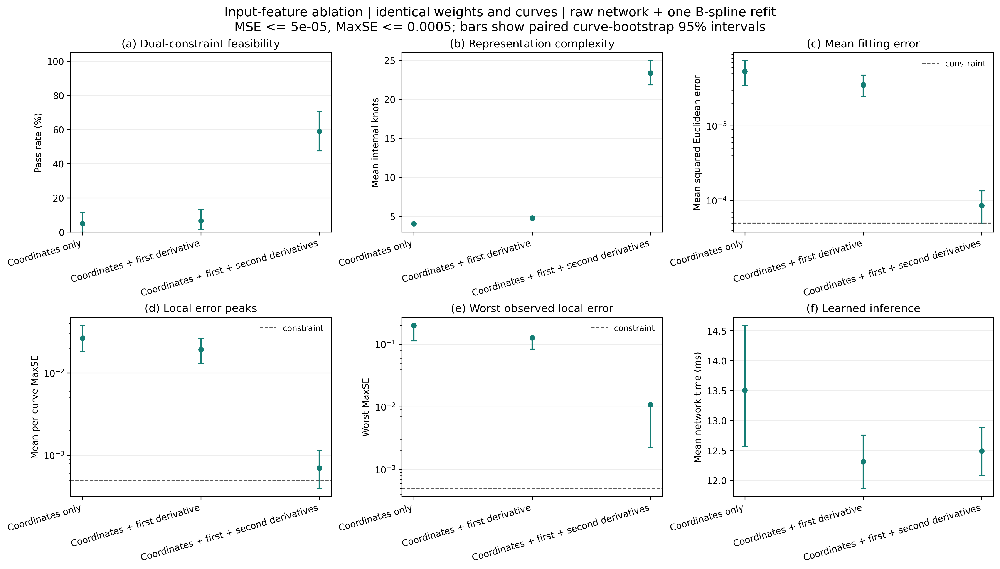
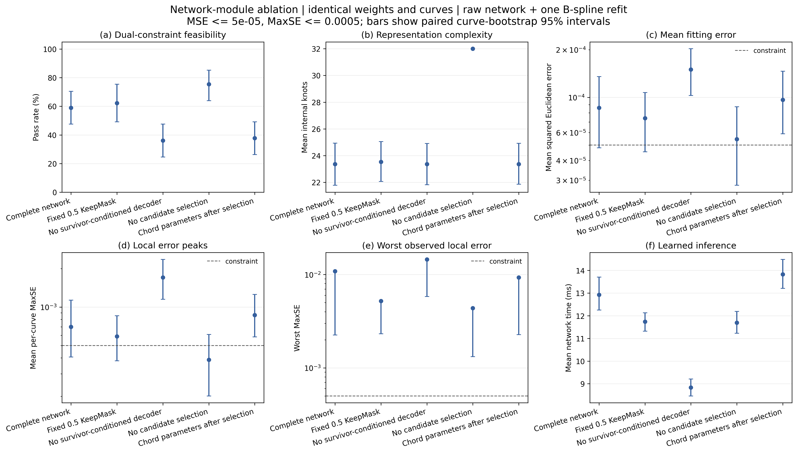

# 面向紧凑 B 样条拟合的学习引导候选节点选择与 KeepMask 条件化重定位

> 中文讨论稿。本文用于检查论文逻辑、技术表述和实验结论，不是最终投稿排版文件。正式英文稿位于同目录下的 `manuscript.tex`。

## 摘要

节点数量和位置会同时影响 B 样条曲线逼近的精度与表示复杂度。联合确定离散节点子集、连续节点坐标和数据点参数是一个混合离散—连续问题；若将节点筛选与位置更新分开处理，容易产生冗余节点或局部误差峰值。本文提出一种面向有序采样点的学习引导候选节点选择方法：首先预测严格单调的点参数和有序冗余候选节点，再由自适应 KeepMask 选择节点子集，并以存活子集为条件联合修正点参数与节点位置；控制顶点最终由端点约束的标准三次 B 样条最小二乘求解获得。

本文把平均平方误差和最大点平方误差同时纳入可行性判据，并在满足双阈值要求的前提下减少内部节点。多轮训练、跨数据源比较和多阈值实验表明，所提方法能够保持较高的双阈值可行率，并在主对比的总体统计中取得六种实现中最低的平均内部节点数，说明候选生成、子集筛选与存活节点重定位的联合建模能够有效改善拟合精度与表示紧凑度之间的平衡。

**关键词：** B 样条拟合；节点选择；曲线参数化；交叉注意力；误差约束；模型简化

---

## 1. 引言

有序点列拟合是逆向工程、轨迹处理、地图概化和制造几何中的基础任务。B 样条具有局部可控、表示紧凑和兼容 CAD 数据结构等优点，但拟合质量并不只由控制顶点决定：数据点参数决定观测点与曲线的对应位置，节点向量决定基函数的支撑和局部自由度，控制顶点则决定嵌入空间中的几何形状。给定点参数与节点向量后，控制顶点可以线性求解；一旦继续优化节点数量和节点坐标，问题便成为混合离散—连续的非线性优化问题。

工程目标也不是在固定的稠密节点向量下单纯降低残差，而是在误差和表示复杂度之间取得平衡。节点过多会增加存储、编辑和后续计算成本，并可能放大噪声；节点过少则难以在局部几何细节附近提供足够自由度。CAD 文献分别使用平滑离散曲率、主导点、自适应细化、稀疏优化和导数特征分布配置节点；CAGD 文献还从几何与微分几何描述子中学习逐位置的节点质量分数。这些研究说明了特征感知节点配置的重要性，但节点数量、节点位置和数据参数化通常仍由分离阶段或多次重复拟合确定。

类似耦合关系也存在于曲面重建。特征敏感曲面参数化可以给高曲率区域分配更大的参数空间，即使采用均匀节点也能在这些区域配置更多控制自由度；迭代几何拟合通过反复调整曲面控制网格逼近点数据；法向参与的目标函数则用于改善复合曲面的光顺性。本文并不处理张量积曲面，但这些 CAD/CAGD 工作共同揭示了一条原则：参数化、表示容量和拟合变量不宜被视为互不相关的输出。

学习方法可以把上述结构判断摊销到大量曲线，同时保留标准 B 样条作为部署结果。关键困难在于可变模型阶数：对固定候选集合逐点独立阈值化，无法描述存活节点之间的组合影响。删除一个候选会改变相邻区间长度，剩余节点和点参数往往也应随之移动。因此，本文采用子集条件化建模，而不是在网络末端附加一个彼此独立的二分类剪枝层。

本文提出一种面向有序曲线样本的学习引导候选选择流程。网络先预测严格单调的点参数和过完备有序候选集合，再生成一个自适应 KeepMask，并以最终存活子集为条件执行存活节点交互、点参数修正和有界节点重定位。最终参数和节点被交给端点约束最小二乘求解器；网络不直接预测控制顶点。阈值实验中的残差插入与验证删除作为单独披露的数值评估包装器，不属于学习架构。

实验由多轮训练与验证、四档阈值扫描、跨数据源配对比较和典型案例分析组成，覆盖独立合成样条、手写轨迹、海岸线、地形等高线和程序生成工业等距线。每档 MSE 阈值均配套最大点平方误差限制；所有尝试样本均保留在通过率分母中，并同时报告可行率、内部节点数、平均误差、最大误差和完整时间。用于主表的固定配对审计子集及其样本构成在第 7.2 节单独说明。**五种文献对照方法均为公开说明的仓库适配实现，不应解释为作者原始软件的精确复现。**

本文的主要贡献如下：

1. 提出面向有序曲线样本的几何与参数联合编码方式，将弦长归一化差分、严格单调参数预测和参数域位置编码连接起来，并以局部交叉注意力产生高召回的有序候选节点。
2. 设计 KeepMask 条件化的存活节点交互机制，使硬筛选结果进一步改变注意力记忆、邻域几何、点参数和节点坐标更新，而不是仅在网络末端删除若干输出。
3. 建立多阈值、跨数据源的统一实验协议，区分网络原始输出与数值评估包装器，并同时报告误差、通过率、内部节点数量和完整耗时。
4. 在合成曲线、手写轨迹、海岸线、等高线和工业模型等距线上进行六方法配对实验，并保留所有失败样本以分析方法的适用范围。

本文余下部分安排如下：第 2 节回顾参数化、节点自适应与学习式样条拟合；第 3 节定义采样误差约束下的目标；第 4、5 节分别给出整体流程与网络组成；第 6 节说明训练监督；第 7、8 节介绍实验协议和结果；第 9、10 节讨论局限并总结全文。

---

## 2. 相关工作

### 2.1 传统参数化、控制顶点求解与节点调整

当点参数和节点向量固定时，B 样条曲线对控制顶点是线性的，可以通过标准最小二乘稳定求解；节点位置一旦成为变量，问题便转化为非线性的自由节点逼近。[Jupp（1978）](https://doi.org/10.1137/0715022)通过分离线性控制变量和非线性节点变量阐明了这一困难，[Yeh 等（2020）](https://doi.org/10.1016/j.cad.2020.102905)进一步说明节点数量和位置会显著改变逼近精度。这个结论决定了本文的基本分工：网络预测参数化和节点结构，而控制顶点仍交给显式线性求解器。

参数化方法为拟合提供稳定的几何对应。[Lee（1989）](https://doi.org/10.1016/0010-4485(89)90003-1)系统比较了均匀、弦长和向心参数化；[Wang 等（2006）](https://doi.org/10.1145/1138450.1138453)通过几何距离目标迭代调整对应关系。它们的优点是定义清楚、无需节点标签，但固定参数化未必适合所有局部几何。本文保留弦长参数的稳定性，把它作为单调参数预测的锚点，再学习受限修正，并用同一参数变换同步更新节点，避免点参数与节点坐标落入两个不一致的参数域。

特征驱动方法侧重回答“节点应放在哪里”。[Li 等（2005）](https://doi.org/10.1016/j.cad.2004.09.008)用平滑离散曲率刻画局部复杂度，[Park 和 Lee（2007）](https://doi.org/10.1016/j.cad.2006.12.006)以主导点驱动自适应细化，[Yeh 等（2020）](https://doi.org/10.1016/j.cad.2020.102905)根据导数特征分布配置节点。这类方法计算直接、具有几何解释性，但节点数量通常仍依赖预设规则或重复细化。本文继承其“在几何变化显著处增加候选覆盖”的思想，用坐标、一阶差分和二阶差分构造保序特征，再通过局部交叉注意力一次性生成高召回候选，而不在候选阶段过早决定最终节点数。

优化驱动方法更直接地处理“保留多少节点”。[Liang 等（2017）](https://doi.org/10.1088/1361-6501/aa6a05)以误差界指导节点插入，优点是每次细化都响应当前残差；[Dung 和 Tjahjowidodo（2017）](https://doi.org/10.1371/journal.pone.0173857)直接优化连续节点位置，能够在固定模型阶数下细化坐标；[Kang 等（2015）](https://doi.org/10.1016/j.cad.2014.08.022)通过稀疏选择分离过完备基中各节点的贡献；[Luo 等（2022）](https://doi.org/10.4208/jcm.2012-m2020-0203)将 $\ell_{\infty,1}$ 模型与差分进化结合，以全局搜索改善节点组合。这些方法分别提供了明确的误差反馈、位置移动或稀疏性，但也通常需要顺序拟合、预设模型阶数或较昂贵的迭代搜索。本文将这些离散结构判断摊销到一个选择网络中，同时让保留下来的节点继续重定位，从而兼顾一次性子集预测与连续坐标修正。

经典节点插入与删除分别可追溯到 [Boehm（1980）](https://doi.org/10.1016/0010-4485(80)90154-2)和 [Tiller（1992）](https://doi.org/10.1016/0010-4485(92)90012-Y)。[Lyche 和 Mørken（1988）](https://doi.org/10.1093/imanum/8.2.185)把精度—复杂度折中表述为给定扰动容差下的数据压缩问题。它们的共同优点是每一次编辑都可以接受显式误差检查。本文完整部署系统沿用这一原则：残差插入和验证删除均重新拟合控制顶点，并以 MSE 与 MaxSE 同时达标作为接受条件；但该过程不是经典形状保持插入或删除的原样实现。

### 2.2 曲面拟合与几何感知参数化

曲面拟合进一步说明参数化与表示容量不能完全分离。[Lai、Hu 和 Pottmann（2006）](https://doi.org/10.1016/j.cad.2006.04.007)把更多参数空间分配给高曲率区域，使均匀节点也能产生非均匀的控制自由度；本文采用参数位置编码和参数域局部注意力实现相似的“几何特征—参数容量”联系。[Kineri 等（2012）](https://doi.org/10.1016/j.cad.2012.02.011)通过迭代几何插值/逼近逐步修正 B 样条曲面，说明一次结构判断后仍需几何更新；本文对应地在 KeepMask 确定后重算存活邻域并移动剩余节点。[Seiler、Großmann 和 Jüttler（2018）](https://doi.org/10.1016/j.cagd.2018.06.005)利用点与法向约束改善复合曲面的局部质量，体现了仅看全局均值可能掩盖局部缺陷；本文虽不使用法向约束，但以 MaxSE 阈值显式限制采样位置上的最坏局部偏差。上述工作处理的是曲面而非一维节点子集，其作用是提供设计原则，而不是作为直接对照算法。

### 2.3 学习式参数化与节点预测

学习方法的主要价值是把逐曲线的结构搜索摊销为一次前向预测。早期工作已表明参数化和节点可以相互依赖地学习：[Laube 等（2018）](https://doi.org/10.1109/3DV.2018.00084)使用关联网络预测参数和节点，[Scholz 和 Jüttler（2021）](https://doi.org/10.1016/j.cagd.2021.101977)以残差网络学习多项式曲线参数化，[Song 等（2024）](https://doi.org/10.1111/cgf.15240)将参数选择写成有监督分类，[Tang 和 Yang（2025）](https://doi.org/10.1016/j.cad.2025.103897)则采用逐实例神经求解器优化参数化。这些方法能够吸收数据分布先验，但主要关注连续参数或固定结构下的预测。本文因此把点参数与节点选择放在同一条数据流中，并在子集确定后再次利用存活节点记忆修正参数，而不是只在输入端预测一次参数。

针对节点结构，[Laube 等（2018）](https://doi.org/10.1016/j.cagd.2018.03.019)的支持向量机方法从几何与微分几何描述子学习逐位置的节点质量分数，优点是评分具有明确局部含义；[Wen 等（2024）](https://doi.org/10.1016/j.cad.2023.103668)把节点优化改写为逐实例无监督神经求解，[Saillot 等（2024）](https://doi.org/10.1016/j.matcom.2024.04.010)研究 Transformer 节点向量预测；[SplineGen（2025）](https://doi.org/10.1016/j.cad.2024.103809)通过交互式自回归解码器产生变长度参数与节点序列；[Tang 等（2026）](https://doi.org/10.1016/j.cad.2026.104059)显式联合优化参数化和节点位置；[PRUMAT（2026）](https://doi.org/10.1016/j.matcom.2026.06.016)则用点相对节点矩阵在固定尺寸输出中编码可变长度节点与重数。上述方法说明神经模型可以表达可变节点结构，但自回归生成、逐实例优化或逐位置独立评分仍可能带来顺序开销，或忽略删除一个节点后其余节点关系的变化。本文选择固定容量的并行候选表示，只作一次 KeepMask 决策，再让该子集重构存活节点的邻域和注意力记忆，以专门处理“筛选改变位置更新条件”这一问题。

两类相邻工作进一步界定本文的输出。[NURBS-Diff（2022）](https://doi.org/10.1016/j.cad.2022.103199)提供可微 NURBS 求值与 CAD 变量梯度，适合把几何误差传回连续变量，但并不直接求解最小离散节点子集；[InceptCurves（2024）](https://doi.org/10.1007/s00371-024-03477-1)预测均匀 B 样条或细分曲线的控制点数量与坐标，而本文预测非均匀内部节点结构，并保留显式最小二乘控制顶点求解。本文因此不以“首次神经节点预测”为贡献，而把重点放在双阈值可行性下的候选覆盖、曲线级子集选择和 KeepMask 条件化重定位。

### 2.4 本文定位

现有路线各有清晰优势：特征法提供快速、可解释的位置先验；误差驱动插入提供直接的可行性反馈；连续优化能够细化节点坐标；稀疏方法能够从过完备表示中压缩结构；学习方法则能把重复搜索摊销到数据分布上。本文把这些优点组织为“高召回候选—MSE 条件化子集筛选—存活节点重定位”三阶段网络，并在完整部署系统中保留标准 B 样条重拟合与 MSE/MaxSE 双阈值验证。

本文并不取代经典数值求解，也不声称获得全局最少节点。网络给出一次性结构预测，训练 Teacher 依据训练 MSE 评估候选子集，完整部署包装器再以 MSE 与 MaxSE 双阈值检查编辑后的局部可行性。五种文献方法在实验中共享输入、节点上限和误差定义，但没有逐项复现其原始软件中的全部目标、连续性模型和求解器细节；因此结果只用于比较本文公开的适配实现，不应被解释为对原论文方法的普遍排序。

---

## 3. 问题定义

输入为沿曲线遍历方向排序并归一化到统一尺度的点列 $\mathbf Q=(\mathbf q_i)_{i=1}^{M}$，其中 $\mathbf q_i\in\mathbb R^d$。本文用次数 $p=3$ 的开区间夹持 B 样条逼近这些观测点。若内部节点为 $0<u_1<\cdots<u_K<1$，则完整节点向量写为

$$
\mathbf U=(\xi_r)_{r=1}^{K+8}
=(0,0,0,0,u_1,\ldots,u_K,1,1,1,1),
$$

相应曲线为

$$
\mathbf C(t)=\sum_{a=1}^{K+4}B_{a,3}(t;\mathbf U)\mathbf P_a,
\qquad t\in[0,1].
$$

其中，$\mathbf P_a\in\mathbb R^d$ 为控制顶点，$B_{a,3}$ 为三次 B 样条基函数。基函数由 Cox--de Boor 递推定义：

$$
B_{a,0}(t)=
\begin{cases}
1, & \xi_a\leq t<\xi_{a+1},\\
0, & \text{其他},
\end{cases}
$$

$$
B_{a,p}(t)=
\frac{t-\xi_a}{\xi_{a+p}-\xi_a}B_{a,p-1}(t)
+\frac{\xi_{a+p+1}-t}{\xi_{a+p+1}-\xi_{a+1}}B_{a+1,p-1}(t),
\qquad p=1,2,3,
$$

其中零分母对应的项按零处理，并采用 $t=1$ 处最后一个基函数取 1 的端点约定。每个 $B_{a,3}$ 只在局部区间 $[\xi_a,\xi_{a+4})$ 上非零，全部基函数在参数域内非负且和为 1。因此，移动或删除一个内部节点主要改变邻近基函数的支撑，但也会改变相应最小二乘系统；这正是节点选择和剩余节点位置不能完全分开优化的数学原因。

观测点并未自带参数，因而还需估计严格递增的对应关系

$$
0=t_1<t_2<\cdots<t_M=1.
$$

给定 $\mathbf t=(t_i)$ 和 $\mathbf U$ 后，曲线对控制顶点是线性的。本文固定 $\mathbf P_1=\mathbf q_1$、$\mathbf P_{K+4}=\mathbf q_M$，其余控制顶点由一次端点约束最小二乘求解。这样，网络只处理点参数、节点数量与节点坐标三个非线性结构变量，而不替代成熟、可检查的 B 样条线性求解器。$K$ 只统计内部节点；对于三次样条，每增加一个简单内部节点就增加一个控制顶点和一份局部自由度，因此 $K$ 同时刻画模型容量、存储规模和后续编辑复杂度。

仅最小化平均残差可能掩盖少数位置上的严重偏离。为同时约束整体拟合和局部最坏偏差，本文在对应参数位置定义平方欧氏残差

$$
e_i=\|\mathbf C(t_i)-\mathbf q_i\|_2^2,
$$

并使用

$$
\operatorname{MSE}=\frac{1}{M}\sum_{i=1}^{M}e_i,
\qquad
\operatorname{MaxSE}=\max_{1\leq i\leq M}e_i.
$$

两项指标均不取平方根。MSE 描述整条曲线的平均逼近质量，MaxSE 则阻止模型用大量小残差掩盖孤立的局部误差峰值。给定平均误差阈值 $\varepsilon$、最大点误差阈值 $\delta$ 和候选容量上限 $K_c$，本文的目标是

$$
\begin{aligned}
\min_{K,\,\mathbf t,\,\mathbf U}\quad &K\\
\text{使得}\quad
&0\leq K\leq K_c,\\
&0=t_1<\cdots<t_M=1,\qquad 0<u_1<\cdots<u_K<1,\\
&\operatorname{MSE}(\mathbf t,\mathbf U,\mathbf P^*)\leq\varepsilon,\\
&\operatorname{MaxSE}(\mathbf t,\mathbf U,\mathbf P^*)\leq\delta,
\end{aligned}
$$

其中 $\mathbf P^*$ 表示在当前 $\mathbf t$ 和 $\mathbf U$ 下重新求得的最优控制顶点。这里的优先关系很重要：误差可行性是约束，节点最少是可行域内的复杂度目标；不能通过删除节点降低 $K$，却让 MSE 或 MaxSE 超出阈值。

这一目标同时包含离散子集选择、连续参数化、连续节点重定位和嵌套的控制顶点求解，直接全局优化代价很高。本文因此先学习高召回的过完备候选，再预测满足曲线容量需求的 KeepMask，并以存活子集为条件更新点参数与节点位置。当前论文检查点的 Teacher 与选择损失以 MSE 阈值 $\varepsilon$ 建立可行性和复杂度监督；局部拟合项另外抑制参数分区和端点附近的误差集中，但不等价于 MaxSE 证书。最大误差阈值 $\delta$ 被显式用于完整部署系统：当 MSE 或 MaxSE 任一越界时执行残差插入，验证删除也只有在两项均不越界时才接受，最终通过率同样要求两项同时达标。因此，$\delta$ 不是事后附加的一列统计量，但其作用应准确理解为数值部署约束，而不是该历史检查点已经学习到的硬保证。

上述误差仅在输入采样点的预测参数位置上计算，不等价于 Hausdorff 距离，也不能证明采样点之间的连续参数区间满足同一误差界。端点闭合和周期曲线的区别属于输出模型约定，在第 5.7 节单独说明。

---

## 4. 整体框架

### 4.1 任务分解

式中的目标同时包含离散决策与连续优化：网络既要判断保留哪些节点，又要预测点参数和节点坐标；控制顶点则在这些结构变量确定后显式求解。若直接回归一个短节点向量，会遇到两个问题：不同曲线的输出长度不同；一旦早期节点数量判断错误，后续位置回归便很难恢复可行解。相反，若始终保留一个很大的固定节点向量，虽然容易降低拟合误差，却无法形成紧凑表示。

因此，本文不直接预测最终的短节点向量，而是将网络主体拆分为“先覆盖、再选择、后重排”的三个衔接阶段。前一阶段的输出不仅作为后一阶段的输入，还会改变后一阶段允许使用的几何关系。

**图 1  本文整体框架。** 上方实线表示部署路径：有序采样点经过几何/参数编码、冗余候选生成、自适应筛选与存活节点条件化重定位后，只执行一次端点约束的标准三次 B 样条重拟合。同一个 KeepMask 不仅决定输出长度，还决定后续参数更新与节点重定位所能读取的注意力记忆和邻域。下方虚线只在训练时提供合成参数/节点标签和反事实子集监督；阈值实验中的残差插入与验证删除属于评估包装器，因此没有画入网络主体。

| 核心困难 | 设计选择 | 采用原因 |
|---|---|---|
| 最终节点向量长度未知 | 先生成固定上限的有序候选，再自适应筛选 | 在确定最终节点数之前优先保证候选召回率 |
| 筛选与位置相互影响 | KeepMask 条件化的存活节点交互与有界重定位 | 删除节点会改变相邻区间，筛选和坐标不能独立预测 |
| 参数化存在数据依赖 | 弦长锚定的参数预测，并用同一参数变换同步移动节点 | 保持采样点与节点处于统一参数坐标系 |
| 输出需要兼容 CAD | 采用标准三次 B 样条最小二乘重拟合 | 让学习模块专注于参数化和节点结构，控制顶点仍显式可解 |

### 4.2 三个阶段如何衔接

这里不能把候选生成、节点筛选和位置更新设计成三个互不相干的输出头。首先，候选集合必须覆盖可能产生大残差的参数区域；一旦第一阶段完全漏掉某个区域，后续筛选器无法凭空恢复该处的自由度。其次，全部保留候选虽然容易降低误差，却与最少节点目标冲突。最后，删除一个节点会立刻改变相邻区间、基函数支撑范围以及合适的点参数和节点坐标，因此“删除谁”和“剩余节点移到哪里”不能独立处理。

基于上述约束，前向过程按“建立可行搜索空间—压缩离散结构—在删除后恢复连续适应性”的顺序组织。阶段 I 优先保证召回，阶段 II 只做一次曲线级子集决策，阶段 III 把该子集当作新的几何上下文，并同步修正点参数和存活节点。这个次序对应约束优化的优先级：先避免不可逆的候选漏检，再去除冗余，最后补偿离散编辑引起的连续变量变化。

**图 2  三个阶段的数据接口。** 阶段 I 输出 $S_1=\{\mathbf F,\mathbf t^{(p)},\mathbf U^{(p)},\mathbf h,\varepsilon\}$，即点记忆、统一参数坐标系和有序冗余候选；阶段 II 输出 $S_2=\{\mathbf m,K,\mathbf h_{\mathrm{surv}}\}$，同一个 KeepMask 同时确定节点数量、存活序列和下游可见记忆；阶段 III 输出 $S_3=\{\mathbf t',\mathbf U'[\mathbf m]\}$，形成严格有序的可变长节点向量。显式控制顶点求解器只读取原始观测和 $S_3$，不读取被删除的候选或 Teacher 标签。

#### 阶段 I：保序参数编码与冗余候选生成

第一阶段读取完整有序点列。GeometryEncoder 将坐标、弦长归一化一阶差分和二阶差分编码为逐点特征 $\mathbf F$；ParameterHead 以弦长参数为稳定参考，预测严格递增的初始点参数 $\mathbf t^{(p)}$。参数位置编码随后写回逐点特征，使网络同时知道局部几何内容及其在 $[0,1]$ 参数域中的位置。

CandidateKnotHead 使用 $K_c+1$ 个有序区间 query，通过带 Gaussian 局部偏置的交叉注意力读取点特征，输出 $K_c$ 个有序候选节点 $\mathbf U^{(p)}$ 及对应候选 token $\mathbf h$。这里的 $K_c$ 是候选容量而不是最终节点数量。本阶段允许适度过生成，目标是使真实重要区域至少有候选覆盖；如果某个区域在此处完全漏检，后续筛选器无法凭空补回节点。

因此，第一阶段的接口 $S_1$ 向第二阶段传递逐点特征 $\mathbf F$、初始点参数 $\mathbf t^{(p)}$、候选位置 $\mathbf U^{(p)}$、候选表示 $\mathbf h$ 和误差请求 $\varepsilon$。它既给出候选存在的几何证据，又规定这些位置采用的参数坐标系；它回答“可能在哪里需要节点”，但尚不回答“最终保留多少个”。

#### 阶段 II：曲线级容量估计与一次性 KeepMask

第二阶段让候选 token 彼此交互，并结合候选附近的点特征、参数域覆盖情况和请求的 MSE 阈值嵌入，估计每个候选的相对重要性。Selector 输出候选分数以及曲线级偏移 $\beta$，由此得到保留概率。与固定 $0.5$ 阈值不同，模型先汇总整条曲线的概率质量以估计请求节点数，再通过稳定 Top-$K$ 选出对应候选；覆盖锚点用于避免所有节点集中在少数局部区间。实验协议取 $\delta=10\varepsilon$，因此同一个阈值请求确定 MSE 与 MaxSE 两项可行性界限。当前检查点的 Selector 直接学习的是 MSE 条件下的容量与排序；最大误差约束由后续残差插入、验证删除和最终双阈值判定作用于整个节点组合，而不是由单个候选概率独立决定。

该过程只产生一次离散子集决策 $\mathbf m$，即 KeepMask。接口 $S_2$ 包含 $\mathbf m$、节点数 $K$ 和有序存活 token；同一个掩码同时决定最终向量长度、存活邻域、下游注意力记忆以及最后实际提取的节点，不再产生第二套可能冲突的掩码。换言之，第二阶段不是 $K_c$ 个完全独立的二分类器，而是“曲线需要多少容量”和“哪些位置最值得占用这些容量”的联合判断。

#### 阶段 III：以存活子集为条件联合更新参数和节点

硬筛选之后，网络不立即把保留位置当作最终答案。它先根据 KeepMask 重新计算每个存活节点的左右邻域间隔、存活序列排名和总存活数量，并从注意力的 Key/Value 中屏蔽所有已删除候选。Selected-node decoder 因而只能在最终存活集合内部交换信息，被删除节点不再影响重定位结果。

随后，点参数 query 读取同一存活记忆，得到单调的参数修正；节点坐标通过相同的参数变换同步移动，再叠加受邻域约束的有界残差。这样，若某个候选被删除，其相邻节点能够根据新的空隙重新分布，点参数与节点坐标也始终保持在同一参数坐标系中。该阶段输出接口 $S_3=(\mathbf t',\mathbf U'[\mathbf m])$，标准最小二乘求解器再据此计算控制顶点。由于被删除 token 不能重新进入 Key/Value，阶段 III 更新的是最终部署结构，而不是再次细化原始冗余候选。

三个阶段分别解决候选召回、可变容量选择和删除后的几何恢复。它们共享同一条前向链路，但承担不同目标：候选阶段宁可略有冗余，筛选阶段负责压缩，存活节点阶段负责补偿离散删除带来的位置变化。

### 4.3 端到端数据流与训练/部署边界

对于批量有序点列 $\mathbf Q\in\mathbb R^{B\times M\times d}$，网络前向路径为

$$
\mathbf Q
\rightarrow (\mathbf F,\mathbf t^{(p)})
\rightarrow (\mathbf U^{(p)},\mathbf h)
\rightarrow (\mathbf m,\mathbf t',\mathbf U')
\rightarrow \operatorname{BSplineRefit}(\mathbf Q,\mathbf t',\mathbf U').
$$

其中，$\mathbf F$ 是逐点特征，$\mathbf t^{(p)}$ 是初始预测参数，$\mathbf U^{(p)}$ 是冗余候选节点，$\mathbf h$ 是候选 token，$\mathbf m$ 是唯一一次离散子集选择，$\mathbf U'$ 是重定位后的存活节点。符号箭头强调的是信息依赖关系：筛选器读取候选与点特征，重定位器同时读取 KeepMask、候选 token 和点参数，而控制顶点求解器只读取最终的 $\mathbf t'$、$\mathbf U'$ 与原始观测点。

Proposal 与 Joint 只是训练日程的两个阶段，并不表示部署时串联两个独立网络。Proposal 阶段先建立参数预测和高召回候选；Joint 阶段再训练容量判断、KeepMask 和存活节点条件化更新。部署时只执行图 1 上方的一次前向链路和一次标准 B 样条重拟合。图 1 下方的真实参数/节点监督与反事实子集 Teacher 仅在训练时使用；阈值对比中的残差插入和验证删除则属于实验评估包装器，也不在网络前向路径中。

---

## 5. 网络结构

### 5.1 保序几何编码

输入是沿曲线遍历顺序排列的采样点，而不是无序点云。因此，编码器必须保留相邻关系，并区分“空间位置相近但局部切向不同”的点。曲线级归一化后，定义

$$
\Delta\mathbf q_i=\mathbf q_{i+1}-\mathbf q_i,\qquad
\ell_i=\|\Delta\mathbf q_i\|_2,\qquad
h_i=\frac{\ell_i}{\sum_l\ell_l}.
$$

弦长归一化的一阶导数代理为

$$
\mathbf d_i=\frac{\Delta\mathbf q_i}{h_i},
$$

内部点的二阶导数代理为

$$
\mathbf a_i=\frac{\mathbf d_i-\mathbf d_{i-1}}
{\tfrac12(h_i+h_{i-1})}.
$$

每个采样位置的输入通道为

$$
\mathbf x_i=[\mathbf q_i,\mathbf d_i,\mathbf a_i].
$$

三类通道承担不同作用：坐标保留曲线整体形状和端点布局；$\mathbf d_i$ 描述局部切向和参数域速度；$\mathbf a_i$ 对切向变化敏感，可作为离散弯曲线索。除以归一化弦长可以降低非均匀采样密度对差分量级的影响，但并不能使其成为严格微分不变量，因此网络仍需联合读取坐标、一阶和二阶信息，而不是只依赖曲率。[Yeh 等（2020）](https://doi.org/10.1016/j.cad.2020.102905)的结果表明，由导数构造的几何细节特征可以有效指导节点密度分配；本文不把该特征直接转换为固定节点规则，而是将相似线索交给候选网络联合学习。

实现中使用三个宽度为 128、卷积核为 3 的一维卷积块提取局部特征，每个块包含 GroupNorm 和 GELU。一维卷积能够保持连续采样点的局部顺序；[GroupNorm（Wu 和 He，2018）](https://openaccess.thecvf.com/content_ECCV_2018/html/Yuxin_Wu_Group_Normalization_ECCV_2018_paper.html)不依赖 batch 维度上的均值与方差，因此比 BatchNorm 更适合当前受显存限制的小批量训练。编码器输出逐点特征 $\mathbf F=(\mathbf f_i)_{i=1}^M$，并通过全局最大池化得到曲线描述

$$
\mathbf f_g=\max_i\mathbf f_i.
$$

局部序列供后续注意力定位使用，全局特征则描述某类几何模式是否在整条曲线上出现。

### 5.2 弦长锚定的参数编码

节点坐标位于参数域，仅有空间几何特征不足以支持节点查询。首先构造弦长参考

$$
c_1=0,\qquad
c_i=\frac{\sum_{l<i}\ell_l}{\sum_l\ell_l},\qquad c_M=1.
$$

ParameterHead 读取 $[\mathbf f_i,\mathbf f_g]$，预测 $M-1$ 个参数间隔的有界残差。设最小间隔为 $\eta_t$、弦长参考间隔为 $g_i^c=c_{i+1}-c_i$，均值中心化后的残差 logit 为 $r_i$，则严格正间隔写为

$$
g_i=\eta_t+[1-(M-1)\eta_t]
\frac{(g_i^c-\eta_t)_+\exp(r_i)}
{\sum_l(g_l^c-\eta_t)_+\exp(r_l)}.
$$

累积这些间隔即可固定 $t_1=0$、$t_M=1$，并从结构上保证严格单调。曲线级 trust 系数再将预测结果向严格弦长参考适度回拉。选择弦长作为锚点，是因为它确定、保序且通常是合理初值；保留学习残差，则是因为相同的空间行程并不意味着相同的逼近难度。参数节点会显著改变拟合形状与误差，这一点可由 [Lee（1989）](https://doi.org/10.1016/0010-4485(89)90003-1)和 [Scholz、Jüttler（2021）](https://doi.org/10.1016/j.cagd.2021.101977)的研究佐证，因此本文采用“稳定弦长锚点 + 有界学习修正”，而不是完全固定弦长或无约束地直接回归全部参数。

最后，将参数位置编码加入局部特征：

$$
\mathbf M_i=\mathbf f_i+\operatorname{PE}(t_i).
$$

$\mathbf M$ 随后作为候选节点交叉注意力的点记忆。query--key--value 计算与正弦位置编码沿用 [Vaswani 等（2017）](https://proceedings.neurips.cc/paper_files/paper/2017/hash/3f5ee243547dee91fbd053c1c4a845aa-Abstract.html)的基本注意力形式；本文特有的是把位置定义在曲线参数域，并进一步加入 Gaussian 局部偏置与有序区间 query。该步骤将“出现了什么几何结构”与“该结构位于参数域何处”放入同一特征空间，使候选 query 能够进行有位置依据的局部读取。真实节点不会作为 GeometryEncoder 或 ParameterHead 的输入。

### 5.3 冗余候选节点生成

模型设置 $K_c$ 个候选查询，每个查询从带参数位置编码的点特征中读取信息。为避免查询在整条曲线上无约束扩散，交叉注意力加入局部 Gaussian 偏置：

$$
A_{ji}=\operatorname{softmax}_i\left[
\frac{(W_Qh_j)^\top(W_KF_i)}{\sqrt{d_h}}
-\frac{(t_i-u_j)^2}{2\sigma^2}
\right],
$$

$$
\widehat h_j=\sum_i A_{ji}W_VF_i.
$$

第一项为内容相似度，第二项鼓励查询优先读取参数位置附近的局部特征。该 Gaussian 项只是局部性偏置，并不保证查询一定找到曲率极值。

CandidateKnotHead 输出 $K_c$ 个有序候选坐标和相应 token。候选过生成不是最终复杂度，而是一种召回机制：重要区域若完全没有候选，后续选择器无法补救；不必要的候选则可由 KeepMask 筛选掉。

### 5.4 自适应节点选择

选择器融合候选 token、点特征、邻域覆盖信息和 MSE 阈值嵌入，得到每个候选的重要性分数 $a_j$。网络同时预测曲线级阈值偏移 $\beta$：

$$
p_j=\sigma(a_j-\overline a-\beta),
\qquad
m=\sum_{j=1}^{K_c}p_j.
$$

$m$ 被解释为当前曲线需要保留的概率质量，并转换为请求节点数。模型不是简单使用固定 $p_j\geq0.5$ 判断，而是根据概率质量决定数量，再通过稳定 Top-$K$ 选择对应候选。为了避免所有节点聚集在参数域局部区域，当前实现还在四个非空参数分区中优先保留高概率锚点。

这种设计把节点数视为曲线级结构决策，而不是 $K_c$ 个完全独立的二分类结果。当前实验令 $\delta=10\varepsilon$，所以 $\varepsilon$ 的条件输入同时索引一组确定的平均/最大误差要求；Selector 本身不另设一个 MaxSE 二分类头，完整部署包装器依据 $\delta$ 对所选节点组合进行残差修复与删除验收。

### 5.5 KeepMask 条件化的存活节点交互

设第 $j$ 个候选的硬筛选值为 $m_j\in\{0,1\}$，存活节点总数为

$$
K=\sum_jm_j.
$$

对于候选位置 $u_j$，定义其左右最近的存活邻居

$$
u_j^-=\max\bigl(\{0\}\cup\{u_l:l<j,\ m_l=1\}\bigr),
$$

$$
u_j^+=\min\bigl(\{1\}\cup\{u_l:l>j,\ m_l=1\}\bigr),
$$

以及它在当前存活子集中的相对排名

$$
\rho_j=\frac{\sum_{l\leq j}m_l}{K+1}.
$$

由此构造 KeepMask 条件化几何向量

$$
\mathbf g_j=
\left[u_j-u_j^-,\ u_j^+-u_j,\ \rho_j,\ K/K_c\right],
$$

再通过 MLP 写回候选 token：

$$
\mathbf z_j=\mathbf h_j+\operatorname{MLP}_g(\mathbf g_j).
$$

这里的“KeepMask 条件化嵌入”并不是简单查询一个“保留/删除”二值向量。只要任意相邻候选被删除，当前节点的左右间距、存活排名和总存活数都会重新计算，因此即使节点 $j$ 自身仍被保留，其表示也会随整个节点组合发生变化。

后续 survivor memory 只包含存活 token：

$$
\mathcal S=\{\mathbf z_j\mid m_j=1\}.
$$

为了批量计算，实现中仍保留 $K_c$ 个存储槽，但通过 key-padding mask 禁止被删除候选充当注意力的 Key 或 Value；只有在空子集情况下才暴露一个零哨兵。存活 token 之间首先进行自交互：

$$
\widehat{\mathbf z}_j=
\operatorname{LN}\!\left(
\mathbf z_j+
\operatorname{Attn}(\mathbf z_j,\mathcal S,\mathcal S)
\right).
$$

随后，逐点参数 query 读取同一存活记忆：

$$
\widehat{\mathbf f}_i=
\operatorname{LN}\!\left(
\mathbf p_i+
\operatorname{Attn}(\mathbf p_i,\mathcal S,\mathcal S)
\right),
$$

$$
\mathbf p_i=\mathbf f_i+\operatorname{PE}(t_i)+\mathbf e_{\varepsilon},
$$

其中 $\mathbf e_{\varepsilon}$ 表示目标 MSE 阈值嵌入；在当前协议中，它也通过 $\delta=10\varepsilon$ 唯一确定对应的最大误差目标。

这一结构有四个直接作用：

1. 被删除 token 不会通过注意力继续向最终解码器泄漏几何信息；
2. 解码器读取的是实际存活节点间距，而不是固定候选网格间距，包括跨越多个被删除候选形成的大区间；
3. 相对排名和存活总数使网络能够区分同一局部特征处于稀疏表示还是稠密表示；
4. 点到存活节点的交叉注意力使离散筛选结果能够先改变点参数，再参与节点重定位。

因此，KeepMask 决定的不只是最终导出哪些坐标，还决定剩余坐标如何被解释和更新。节点贡献具有组合依赖：在完整候选集中冗余的节点，在邻居消失后可能重新变得必要。训练时，预测 mask 和 Teacher mask 都必须通过同一套存活节点解码器重新计算几何；若只监督二值 mask 而不重新解码，就与真实部署过程不一致。

### 5.6 参数与节点位置联动更新

存活节点特征用于更新相邻点参数间隔。设初始间隔为

$$
g_i=t^{(p)}_{i+1}-t^{(p)}_i,
$$

网络预测有界修正 $\bar r_i$，并重新分配扣除最小间隔后的自由质量：

$$
w_i=\frac{(g_i-\eta_t)_+\exp(\bar r_i)}
{\sum_l(g_l-\eta_t)_+\exp(\bar r_l)},
$$

$$
\widehat g_i=\eta_t+[1-(M-1)\eta_t]w_i.
$$

累积 $\widehat g_i$ 得到新的单调参数提议，再通过曲线级 trust 系数与原参数混合。

点参数变化后，候选节点必须同步转换。对于 $u\in[t_i,t_{i+1}]$，采用分段线性映射：

$$
\mathcal W(u;\mathbf t,\mathbf t')=
t'_i+\frac{u-t_i}{t_{i+1}-t_i}(t'_{i+1}-t'_i).
$$

随后，存活节点根据其相邻存活节点和相对排序进行有界位移，并通过有序间隔投影保证

$$
0<u'_1<u'_2<\cdots<u'_K<1.
$$

当前正式实验使用的检查点只执行一次上述 survivor-conditioned 解码，不包含后期实验版本中的多轮重复 refinement block。

### 5.7 B 样条输出

筛选和调整后的内部节点组成开区间夹持节点向量。在预测参数上建立三次 B 样条基矩阵，并通过第 3 节所定义的一次端点约束 float64 最小二乘求解控制顶点；网络不直接回归控制顶点。当前方法强制曲线插值两个端点，不使用控制多边形平滑正则。当输入首尾采样点相同时，两个固定端点控制顶点也相同，所以曲线与控制多边形在位置上闭合；求解器不会因此把它转换为周期样条，也不保证接缝的一阶、二阶连续。该标准 B 样条重拟合结果就是网络架构的原始输出，也是方法结构描述的终点。

阈值对比实验另外记录一个传统后拟合包装器：当 MSE 或 MaxSE 任一越界时，它可以在高残差位置插入节点；也可以验证删除某个单节点后是否仍同时满足两项误差要求。该过程没有可学习参数，不属于网络模块，其使用范围、计时方式和方法间的不对称性统一放在实验协议中说明。

---

## 6. 训练方法

### 6.1 为什么采用 Proposal 与 Joint 两阶段

如果候选网络尚未覆盖真实重要区域，就立即训练筛选器，筛选器只能在错误候选中做选择。因此，Proposal 阶段首先优化：

- 稠密候选拟合能力；
- 点参数预测；
- 有序候选与合成真实节点之间的匹配；
- 候选节点召回率与参数域覆盖率。

当候选集合已经具有较高召回率后，Joint 阶段再启动 KeepMask、数量校准、存活节点位置调整和子集拟合。Joint 初始校准期暂时冻结 Proposal 几何，使选择器不能通过随意移动候选来降低筛选损失；之后以较小学习率联合微调 Proposal。

### 6.2 反事实可行 Teacher

真实合成节点提供的是原始曲线表示，但它不一定是在当前噪声、参数化和误差阈值下的最小节点子集。另一方面，Hard Top-$K$ 是离散操作，无法仅依靠普通梯度学习“删除哪个节点仍然可行”。

因此，Joint 训练中采用有限预算的数值 Teacher，对随机子集、概率前缀以及有限的增加、删除和交换操作进行试验。Teacher 要回答的问题是：

> 对当前曲线而言，是否存在更小或不同的候选子集，在重新解码和拟合后仍满足训练 MSE 阈值？

候选 Teacher mask 必须重新通过同一个存活节点解码器，并执行标准 B 样条拟合。当前论文检查点以重新解码后的 $\operatorname{MSE}\leq\varepsilon$ 作为 Teacher 可行标签，并通过局部分区/端点拟合项降低误差集中。这里必须区分训练标签与完整系统验收：Teacher 不提供 MaxSE 证书；$\operatorname{MaxSE}\leq\delta$ 由第 7.4 节的数值部署包装器在残差插入和验证删除时显式检查。

Teacher 是训练期间的数值指导，不是额外的神经网络，也不参与部署。

### 6.3 损失函数分组

Proposal 阶段可概括为

$$
\mathcal L_{\text{prop}}=
\lambda_d\mathcal L_{\text{dense}}
+\lambda_t\mathcal L_{\text{parameter}}
+\lambda_v\mathcal L_{\text{coverage}}
+\lambda_u\mathcal L_{\text{ordered-position}}.
$$

Joint 阶段可概括为

$$
\begin{aligned}
\mathcal L_{\text{joint}}={}&
\lambda_f\mathcal L_{\text{selected-fit}}
+\lambda_m\mathcal L_{\text{mask}}
+\lambda_c\mathcal L_{\text{count}}\\
&+\lambda_r\mathcal L_{\text{rank}}
+\lambda_g\mathcal L_{\text{teacher-geometry}}
+\lambda_K\mathcal L_{\text{complexity}}.
\end{aligned}
$$

$\mathcal L_{\text{selected-fit}}$ 按照 $\operatorname{MSE}/\varepsilon$ 惩罚选中子集的平均误差越界；局部拟合辅助项还计算四个参数分区和两个端点区域的残差，以降低少数区域被全局平均掩盖的风险。mask、count 和 rank 损失用于蒸馏经过重新解码和 MSE 验证的 Teacher 选择；参数、覆盖率和有序位置损失仅在具有真实标签的合成样本上启用；复杂度损失只在具备训练可行性依据时鼓励减少节点。

代码同时支持可选的精确 MaxSE/最差尾部残差损失，但当前论文所报告 K32 检查点的该项权重为 0，不能把它写成已训练机制。本文结果中的最大误差阈值由完整部署包装器执行：若 MSE 或 MaxSE 任一未达标则尝试残差插入，删除节点也必须同时保持两项阈值。这样既把最大误差纳入最终优化目标与验收，又避免夸大历史网络权重本身已经提供的能力。

---

## 7. 实验设置

### 7.1 训练配置

当前论文结果对应固定的 K32 历史检查点：

| 项目 | 设置 |
|---|---:|
| 曲线维度 | 2 |
| 每条曲线采样点 | 192 |
| B 样条次数 | 3 |
| 最大内部节点数 | 32 |
| 最大完整节点向量长度 | 40 |
| 最大控制顶点数 | 36 |
| 隐藏维度 | 128 |
| 编码器层数 | 3 |
| 注意力头数 | 4 |
| 选择器层数 | 2 |
| 合成训练/验证数量 | 1500 / 500 |
| Batch size | 32 |
| 坐标噪声标准差 | 0.001 |
| MaxSE 专用训练损失权重 | 0（当前检查点未启用） |
| 配置的 Proposal / Joint 轮数 | 12 / 20 |
| 被选检查点 | epoch 14 |

训练数据由简单解析曲线、程序扰动形状和带标签 B 样条混合组成。真实数据不作为带节点标签的训练样本。当前权重由历史较大容量检查点 warm start 得到，该初始化链在实验元数据中保留。

### 7.2 测试数据

论文还进行了训练/验证监控、多轮模型改进、阈值扫描和案例分析。为保证六种方法逐曲线一一对应，主统计表另外冻结了一个 61 条曲线的配对审计子集：

| 数据源 | 数量 | 说明 |
|---|---:|---|
| Synthetic | 21 | 源内部节点数 4--24 |
| UJI handwriting | 10 | UJI Pen Characters Version 2 |
| Natural Earth coastline | 10 | Natural Earth 1:10m 海岸线 |
| USGS contours | 10 | USGS The National Map 等高线 |
| Industrial offsets | 10 | 程序生成的工业模型等距线 |

Industrial offsets 是 CAD 风格程序生成数据，不是现场测量数据。真实数据集没有真实 B 样条节点向量，因此不计算节点 precision/recall，只比较误差、节点数量、通过率和耗时。

### 7.3 对照方法

对照组包括：

1. Park--Lee 自适应细化适配；
2. Liang 误差约束节点插入适配；
3. Dung 直接节点优化适配；
4. Kang 稀疏优化适配；
5. Luo 稀疏模型与差分进化适配；
6. Ours。

六种方法使用相同归一化输入和相同的 32 内部节点上限，但保留各自适配实现的参数化和控制顶点约定。为在相同的双误差条件下比较，六种原始方法都接入相同的残差节点插入；只有 Ours 继续执行本文提出的验证式后剪枝。因此主实验比较的是完整系统，而不是纯网络一次前向结果。该后处理不对称性必须在论文中明确说明。

### 7.4 数值评估包装器与公平性边界

为了在统一误差阈值下记录各方法结果，六种方法的原始输出均可接入相同的残差插入步骤：当 MSE 或 MaxSE 未达标时，在高残差参数区间测试插入一个节点，并重新求解控制顶点。Ours 的最终系统结果还记录验证式单节点删除：在固定点参数和其余节点位置的条件下，只有删除后仍同时满足两个阈值的节点才会被移除。

这些操作属于实验评估包装器，不是网络前向层，也不作为本文的网络贡献。节点插入和节点删除本身具有经典算法基础，可参见 [Boehm（1980）](https://doi.org/10.1016/0010-4485(80)90154-2)和 [Tiller（1992）](https://doi.org/10.1016/0010-4485(92)90012-Y)；但本文包装器在残差驱动编辑后重新拟合全部控制顶点，因此不等同于形状保持的 Boehm 插入，也不是 Tiller 删除算法的原样实现。公共插入与 Ours 专用删除造成的后处理不对称性需要明确披露。因此，实验文件同时保存原始网络结果、插入后结果和最终结果，并把数值包装器耗时计入完整系统耗时。

### 7.5 指标

主要阈值设置为

$$
\varepsilon=5\times10^{-5},\qquad
\delta=5\times10^{-4}.
$$

只有同时满足 MSE 和 MaxSE 才记为通过。报告指标包括：

- 有限结果数量 / 总请求数量；
- 平均最终内部节点数量；
- 双阈值通过率；
- 平均 MSE；
- 逐曲线 MaxSE 的均值、P95 和总体最大值；
- 完整部署时间。

完整时间包含原方法、参数化、控制顶点拟合、残差插入以及 Ours 的后剪枝。网络前向时间单独保存，但不能代替完整时间。Ours 使用 GPU 推理，而大部分传统优化在 CPU 上运行，因此当前时间只能说明实测系统开销，不能视为严格的硬件无关复杂度比较。

---

## 8. 实验结果

### 8.1 六方法总体结果

在 $\operatorname{MSE}\leq5\times10^{-5}$ 且 $\operatorname{MaxSE}\leq5\times10^{-4}$ 下：

| 方法 | 有效/总数 | 平均内部节点 $K$ | 双阈值通过率 | 平均 MSE | 总体最大 MaxSE | 平均总时间/ms |
|---|---:|---:|---:|---:|---:|---:|
| Ours | 61/61 | **16.64** | 78.7% | $7.528\times10^{-5}$ | $2.984\times10^{-3}$ | 625.87 |
| Park | 61/61 | 21.10 | 59.0% | $1.145\times10^{-4}$ | $1.041\times10^{-2}$ | 106.38 |
| Liang | 61/61 | 19.39 | 67.2% | $8.861\times10^{-5}$ | $3.710\times10^{-3}$ | **78.58** |
| Dung | 60/61 | 16.78 | **80.3%** | **$5.565\times10^{-5}$** | $3.575\times10^{-3}$ | 1033.40 |
| Kang | 61/61 | 18.31 | 77.0% | $6.434\times10^{-5}$ | $3.578\times10^{-3}$ | 2348.05 |
| Luo | 61/61 | 18.30 | 78.7% | $6.952\times10^{-5}$ | $7.326\times10^{-3}$ | 5452.86 |

从固定配对审计结果的总体均值看，Ours 使用的内部节点最少，并且所有请求曲线均返回有限拟合结果。Dung 的双阈值通过率略高，但存在一条数值失败曲线。Ours 的完整时间高于 Park 和 Liang，主要原因是加入了逐节点验证删除；但明显低于 Dung、Kang 和 Luo 的迭代优化时间。

这说明本文方法的主要优势不是每项指标均为第一，而是在较高通过率下获得较低的总体节点复杂度，并保持低于多种连续或演化优化方法的系统耗时。

### 8.2 不同数据源上的表现

| 数据源 | Ours 平均 $K$ | 该数据源最小平均 $K$ | Ours 通过率 |
|---|---:|---:|---:|
| Synthetic | **20.48** | Ours 20.48 | 76.2% |
| UJI | 4.40 | Dung 4.30 | 100.0% |
| Natural Earth | 24.70 | Dung 20.11 | 70.0% |
| USGS | 20.10 | Dung/Luo 19.40 | 50.0% |
| Industrial offsets | **9.30** | Ours 9.30 | 100.0% |

Ours 在合成曲线和工业模型等距线上具有明显的节点简化优势。在简单 UJI 笔画上，各方法只需少量节点，Ours 与最优结果非常接近。Natural Earth 和 USGS 的节点数量及通过率没有占据优势，说明地理曲线的分布偏移仍影响候选位置和 KeepMask 校准。

因此，论文应同时展示优势样本和失败样本，而不能只使用精选成功图代替总体统计。

### 8.3 多阈值敏感性

保持同一个 K32 检查点不变，只改变部署阈值，并令 $\delta=10\varepsilon$：

| MSE 阈值 $\varepsilon$ | 平均内部节点 | 平均逐曲线峰值误差 | 双阈值通过率 | 平均完整时间/ms |
|---:|---:|---:|---:|---:|
| $1\times10^{-5}$ | 21.885 | $3.807\times10^{-4}$ | 62.3% | 410.56 |
| $2\times10^{-5}$ | 19.557 | $3.991\times10^{-4}$ | 70.5% | 426.45 |
| $5\times10^{-5}$ | 16.639 | $4.951\times10^{-4}$ | 78.7% | 422.31 |
| $1\times10^{-4}$ | 14.262 | $6.960\times10^{-4}$ | 86.9% | 487.65 |

阈值从 $10^{-5}$ 放宽到 $10^{-4}$ 后，平均内部节点从 21.89 降至 14.26，说明完整流程能够根据工程精度要求改变表示复杂度。通过率同时从 62.3% 上升到 86.9%，说明严格阈值下仍有一部分复杂曲线即使达到 32 节点上限也不能满足要求。

在最严格的 $10^{-5}$ 阈值下，Ours 的通过率为 62.3%，其余五种实现为 47.5%--59.0%。这一结果说明学习候选在严格误差条件下能够提供较好的初始节点分布，但不能据此推断本文方法在所有数据源、节点数或时间指标上均占优。

### 8.4 输入特征与网络模块的配对消融

为考察已训练检查点实际依赖哪些信息，本节在完全相同的 61 条曲线和同一组权重上逐项干预。特征消融只把相应输入通道置零，不改变张量尺寸和参数量；模块消融每次只替换一个推理决策。所有实验都只执行原始网络和一次端点约束 B 样条重拟合，不使用残差插入或验证式后剪枝。因此，这里衡量的是当前检查点对某项信息或模块的依赖，不能替代“每个变体从头重新训练”的结构消融。

| 分组 | 干预项 | 双阈值通过率 | 平均内部节点 $K$ | 平均 MSE | 平均 MaxSE | 最坏 MaxSE |
|---|---|---:|---:|---:|---:|---:|
| 特征 | 仅坐标 | 4.9% | 4.00 | $5.326\times10^{-3}$ | $2.662\times10^{-2}$ | $1.995\times10^{-1}$ |
| 特征 | 坐标 + 一阶差分 | 6.6% | 4.74 | $3.532\times10^{-3}$ | $1.918\times10^{-2}$ | $1.263\times10^{-1}$ |
| 特征 | 坐标 + 一阶 + 二阶差分 | 59.0% | 23.36 | $8.609\times10^{-5}$ | $7.004\times10^{-4}$ | $1.088\times10^{-2}$ |
| 模块 | 完整网络 | 59.0% | 23.36 | $8.609\times10^{-5}$ | $7.004\times10^{-4}$ | $1.088\times10^{-2}$ |
| 模块 | 固定 $0.5$ KeepMask | 62.3% | 23.52 | $7.390\times10^{-5}$ | $5.888\times10^{-4}$ | $5.201\times10^{-3}$ |
| 模块 | 取消存活节点条件化 decoder | 36.1% | 23.36 | $1.499\times10^{-4}$ | $1.704\times10^{-3}$ | $1.454\times10^{-2}$ |
| 模块 | 不筛选，保留全部候选 | 75.4% | 32.00 | $5.452\times10^{-5}$ | $3.871\times10^{-4}$ | $4.367\times10^{-3}$ |
| 模块 | 筛选后改用固定弦长参数 | 37.7% | 23.36 | $9.644\times10^{-5}$ | $8.659\times10^{-4}$ | $9.321\times10^{-3}$ |

**图 3  输入特征配对消融。** 圆点为总体统计，误差棒为按曲线 bootstrap 得到的 95% 区间。坐标或坐标加一阶差分都会使当前检查点的拟合显著退化，说明该模型强烈依赖弦长归一化二阶差分来识别局部几何变化；但该结论只表示当前权重的依赖性，不能证明“坐标特征经过重新训练仍一定无效”。图中的时间是本机 CPU 诊断值，正式计时应在论文指定硬件上重新生成。

**图 4  网络模块配对消融。** 取消存活节点条件化 decoder 后，通过率由 59.0% 降至 36.1%，说明删除后的节点交互和重定位不是装饰性结构；筛选后改回弦长参数时通过率降至 37.7%，支持点参数与节点共同更新。保留全部 32 个候选可把通过率提高到 75.4%，但失去紧凑性，直接展示了可行性与节点数量之间的矛盾。

固定 $0.5$ 阈值在这组 raw-network 样本上以相近节点数略优于自适应 mass-Top-$K$。因此，现有数据不支持“自适应筛选在所有情况下更优”的表述，反而表明曲线级节点数校准仍需改进。8.1 节主表中完整系统的通过率更高，是因为其还包含已经公开说明的数值修复和后剪枝；本节故意排除这些操作，避免它们掩盖网络模块本身的影响。

---

## 9. 局限性与有效性边界

1. **网络输出与实验包装器必须区分。** 原始网络是一次前向选择与重定位；阈值对比另外记录残差插入和验证式删除，完整系统时间必须包含这些阶段。
2. **主对比后处理不完全对称。** 六种方法均使用公共插入，但只有 Ours 的最终系统结果记录验证式删除。因此需要同时报告 raw、插入后和最终结果，才能区分网络贡献与数值包装器贡献。
3. **没有全局最少节点保证。** 网络学习的是近似子集决策；评估包装器中的删除也只在固定参数和固定剩余节点位置下逐次测试单节点。
4. **没有连续曲线误差保证。** MSE 和 MaxSE 均只在 192 个输入参数位置上计算。
5. **固定配对审计子集仍然有限。** 本文还包含多轮训练、验证和阈值实验，但主六方法统计表采用固定配对子集以保证逐曲线可比；该子集不足以证明跨领域普遍优势。
6. **真实数据缺少节点标签。** 外部曲线无法计算真实节点 precision 和 recall，只能依据拟合误差与复杂度评价。
7. **计时不是严格硬件无关比较。** 网络使用 GPU，而多个对照优化过程主要使用 CPU。
8. **地理曲线和 KeepMask 校准仍是弱项。** Natural Earth 和 USGS 结果表明候选分布存在域偏移；配对消融还显示自适应 mass-Top-$K$ 在 raw-network 样本上没有稳定优于固定 $0.5$ 阈值。
9. **当前不支持严格周期闭曲线。** 工业等距偏移数据重复首尾观测点，端点约束使首尾控制顶点重合，因此能够得到无位置缝隙的 $C^0$ 闭合结果；但编码器边界不是循环边界，节点向量仍为开区间夹持形式，且没有施加 $\mathbf C'(0)=\mathbf C'(1)$ 和 $\mathbf C''(0)=\mathbf C''(1)$。周期参数化、循环 KeepMask 邻域和接缝导数连续性属于后续工作。

---

## 10. 结论

本文提出了一种面向有序采样点的紧凑三次 B 样条拟合框架。该框架通过保序几何编码和弦长锚定参数编码构建点记忆，使用局部交叉注意力生成参数感知的冗余候选节点，通过自适应 probability-mass Top-$K$ 获得可变长度 KeepMask，并利用 KeepMask 条件化的存活节点交互联合更新点参数和节点位置。最后，标准端点约束最小二乘求解控制顶点。

多轮训练、跨数据源配对比较和多阈值实验表明：以 MSE 与 MaxSE 同时达标作为可行性条件后，本文完整系统在主对比的总体统计中取得六种实现最低的平均内部节点数；在更严格的阈值下，学习候选也能提供较高的总体可行率。配对消融进一步表明二阶差分特征、学习参数化和存活节点条件化交互都会实质影响 raw fit。另一方面，本文在部分地理曲线上并未取得最少节点或最高通过率，自适应掩码也未稳定优于固定阈值，且完整阈值评估需要额外数值操作。

因此，当前证据支持如下结论：保序候选生成、KeepMask 筛选和存活节点条件化重定位可以学习有效的节点结构先验，并在部分复杂曲线上改善精度与紧凑度的平衡；但它仍是近似结构预测器，而不是具有连续误差证明或全局最少节点保证的解析算法。

---

## 11. 后续需要补充的论文内容

- 作者姓名、单位、通讯作者和基金信息；
- 根据最终 CAD 版式调整框架图字号与正式图号；
- 六方法五数据源案例图；
- raw network、公共插入、后剪枝三阶段消融；
- 各结构变体独立重新训练，以及 Teacher 开关消融；
- 更大规模独立测试集和重复计时；
- 代码、模型、数据 manifest 和许可声明；
- 与 CAD 投稿规范一致的英文润色和参考文献扩充。
